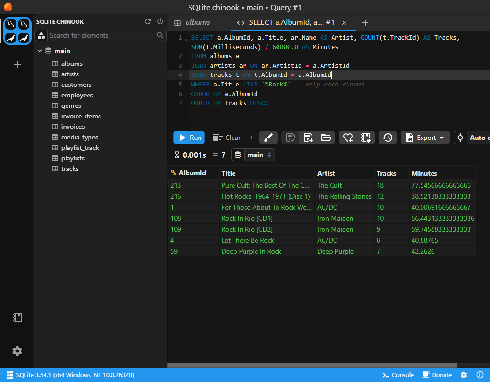

# Chaos

Chaos for Antares: the code editor theme ported from the Ace editor, with a matching interface.

| | |
|---|---|
| Appearance | 🌙 Dark |
| Author | Antares SQL |
| License | BSD-3-Clause |
| Tags | `ace` |

## Install

Download [theme.json](https://raw.githubusercontent.com/antares-sql/themes/main/themes/chaos/theme.json), then in Antares open **Settings → Themes → Import from file**.

<!-- Generated by scripts/build.js from theme.json: edit theme.json, not this file -->
