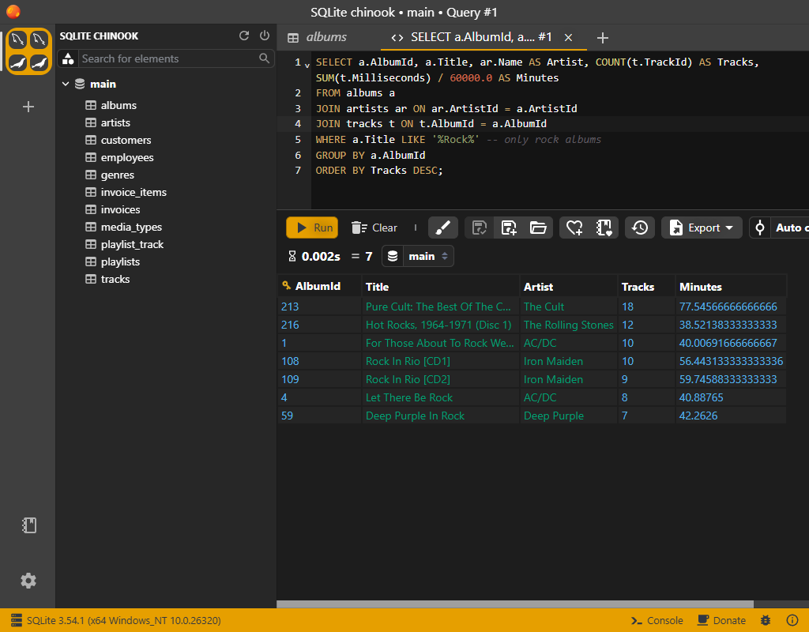

# Dark Color-Blind Safe

Dark Color-Blind Safe: the built-in dark theme with folder, status and data type colors from the Okabe-Ito and Paul Tol palettes, distinguishable with deuteranopia, protanopia and tritanopia. Success and error are bluish green and vermillion instead of green and red.

| | |
|---|---|
| Appearance | 🌙 Dark |
| Author | Antares SQL |
| License | MIT |
| Tags | `accessibility` `color-blind` |

## Install

Download [theme.json](https://raw.githubusercontent.com/antares-sql/themes/main/themes/dark-color-blind-safe/theme.json), then in Antares open **Settings → Themes → Import from file**.

<!-- Generated by scripts/build.js from theme.json: edit theme.json, not this file -->
