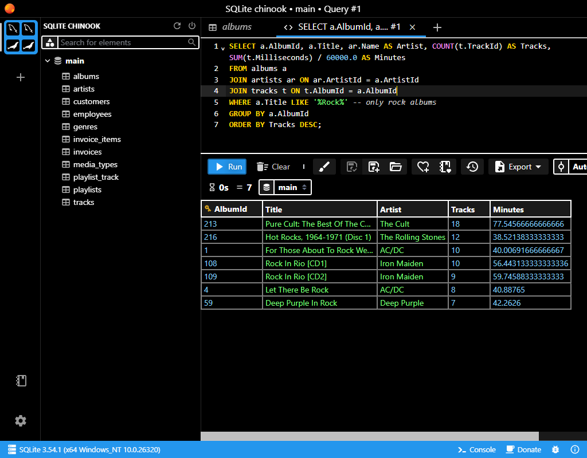

# High Contrast Dark

High Contrast Dark: maximum contrast, thick borders, a strong focus ring and wide scrollbars, for low vision users. Pair it with a larger interface text size (Settings, Themes).

| | |
|---|---|
| Appearance | 🌙 Dark |
| Author | Antares SQL |
| License | MIT |
| Tags | `accessibility` `high-contrast` |

## Install

Download [theme.json](https://raw.githubusercontent.com/antares-sql/themes/main/themes/high-contrast-dark/theme.json), then in Antares open **Settings → Themes → Import from file**.

<!-- Generated by scripts/build.js from theme.json: edit theme.json, not this file -->
